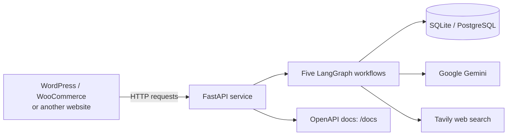

<p align="center">
  
</p>

<h1 align="center">AI Agents for E-Commerce</h1>

<p align="center">
  <strong>FastAPI · LangGraph · Gemini · Tavily · WordPress / WooCommerce</strong><br>
  Five AI-agent workflows exposed through an HTTP API.
</p>

<p align="center">
  <a href="https://ai-agents-service-tdhq.onrender.com/docs">API Documentation</a> ·
  <a href="https://testv3.websitedemolynk.com/discountv2/">Live Demo Shop</a> ·
  <a href="docs/BRD_Capstone_Project.pdf">Business Requirements</a> ·
  <a href="docs/UAT_Checklist.xlsx">UAT Checklist</a>
</p>

> **Demo deployment note:** The API is hosted on Render's free tier and may sleep when idle. The first request after a quiet period can take up to a minute. Check the live service and its current limits before relying on it.

## Overview

**DSSite_Agents** is a Saylani Agentic AI mid-capstone project that separates e-commerce agent workflows from a store's website. A WordPress/WooCommerce shop, or another website with a suitable adapter, can send requests to the FastAPI service over HTTP and receive structured responses.

The agents use LangGraph to coordinate workflow steps. Depending on the workflow, the service can use Google Gemini for language or image understanding, Tavily for web search, and a configured database for application data.

### Project links

| Resource | Link |
|---|---|
| Repository | [Raheel32/DSSite_Agents](https://github.com/Raheel32/DSSite_Agents) |
| Live demo shop | [Discount Shop](https://testv3.websitedemolynk.com/discountv2/) |
| API docs | [FastAPI `/docs`](https://ai-agents-service-tdhq.onrender.com/docs) |
| API health | [`/health`](https://ai-agents-service-tdhq.onrender.com/health) |
| Business requirements | [`docs/BRD_Capstone_Project.pdf`](docs/BRD_Capstone_Project.pdf) |
| UAT checklist | [`docs/UAT_Checklist.xlsx`](docs/UAT_Checklist.xlsx) |

## Features: five agent workflows

| # | Agent | Purpose | LangGraph concepts |
|---:|---|---|---|
| 1 | **Smart Refund & Escalation** | Evaluates refund/cancellation requests against configured rules and routes some cases for administrator review. | Sequential steps, conditional edges, human-in-the-loop, checkpointing |
| 2 | **Product Discovery** | Interprets shopper intent and ranks matching products from the service's catalog. | Parallel branches, `Send`, custom reducer |
| 3 | **Competitor Pricing Auditor** | Searches for comparable products, reviews price evidence, and suggests whether to lower, raise, or keep a price. | Iterative review loop, Tavily tool use |
| 4 | **Order Fraud Detection** | Scores supplied order signals and returns a risk assessment. | Sequential pipeline, state reducer |
| 5 | **Product Onboarding & SEO** | Uses product details and an image payload to draft product copy and SEO fields, then validates the draft. | Gemini vision, iterative refinement |

The repository also includes WordPress PHP snippets for catalog synchronization, AI product search, refund requests, administration, price audits, and product onboarding.

## Architecture



The application entry point is `app.main:app`. The service documents a health endpoint at `/health` and interactive API documentation at `/docs`.

The agents are designed to receive the facts needed for a workflow from the calling website, rather than connecting directly to the store's database. The WordPress integration is provided as PHP snippets under [`wordpress/`](wordpress/).

## API overview

The table below summarizes documented routes. Use the running service's `/docs` page to confirm current request fields, response schemas, and authentication requirements before integration.

| Capability | Endpoint(s) | Purpose |
|---|---|---|
| Fraud screening | `POST /fraud/check` | Assess supplied order signals |
| Fraud administration | `GET /fraud/flagged`, `GET /fraud/history` | Review flagged orders and history |
| Refund request | `POST /refund/request`, `GET /refund/{id}/status` | Submit a request and check its status |
| Refund administration | `GET /refund/requests`, `POST /approve-refund` | Review requests and record an administrative decision |
| Refund dashboard | `GET /admin` | Standalone admin page, if enabled |
| Product recommendations | `POST /recommendations` | Search the service catalog using shopper intent |
| Catalog management | `POST /catalog/products`, `DELETE /catalog/products/{id}` | Add/update or remove catalog items |
| Catalog statistics | `GET /catalog/stats` | Return catalog statistics |
| Product onboarding | `POST /onboarding/product` | Generate and validate product details and SEO copy |
| Competitor pricing | `POST /pricing/audit`, `GET /pricing/audits` | Run an audit and retrieve audit records |
| Pricing audit status | `POST /pricing/audits/{id}/status` | Mark a pricing suggestion as applied or dismissed |
| Health | `GET /health` | Basic health response |
| Root information | `GET /` | Return service information |

Authentication may differ between website-facing and administrative routes. Verify the route implementation and configuration before exposing the service publicly.

## Technology stack

The repository's dependency list includes:

- Python 3.11 (specified by the Render blueprint)
- FastAPI and Uvicorn
- LangGraph and LangChain Core
- `langchain-google-genai` for Gemini integration
- SQLAlchemy
- SQLite for the default local configuration, or PostgreSQL when configured
- `python-dotenv`
- HTTPX
- Tavily Python client

The current dependency file may contain duplicate entries and uses lower-bound versions rather than a fully locked dependency set. For repeatable deployments, clean up and lock dependencies after compatibility testing.

## Getting started

### Prerequisites

- Python 3.11
- Git
- A Google AI API key for Gemini-backed functionality
- A Tavily API key for competitor-pricing search
- Database configuration appropriate for your environment
- WordPress/WooCommerce only if you plan to use the provided PHP snippets

Some code paths may have fallback behavior when Gemini is unavailable, but external-service-dependent functionality may be limited without the relevant API keys.

### 1. Clone the repository

```bash
git clone https://github.com/Raheel32/DSSite_Agents.git
cd DSSite_Agents
```

### 2. Create and activate a virtual environment

**Windows PowerShell**

```powershell
py -3.11 -m venv .venv
.\.venv\Scripts\Activate.ps1
```

If PowerShell blocks activation, use the environment's Python and pip executables directly or follow your organization's execution-policy guidance.

**macOS / Linux**

```bash
python3.11 -m venv .venv
source .venv/bin/activate
```

### 3. Install dependencies

```bash
python -m pip install --upgrade pip
pip install -r requirements.txt
```

### 4. Configure environment variables

Copy the example environment file.

**Windows PowerShell**

```powershell
Copy-Item .env.example .env
```

**macOS / Linux**

```bash
cp .env.example .env
```

Edit `.env` with values appropriate for your environment:

```dotenv
# Local SQLite database; replace with your PostgreSQL connection URL if needed.
DATABASE_URL=sqlite:///./agents.db

# Required for Gemini-backed functionality.
GOOGLE_API_KEY=replace_with_your_google_ai_api_key

# Required for competitor-pricing web search.
TAVILY_API_KEY=replace_with_your_tavily_api_key

# Use long, random secrets. Never use placeholders in production.
ADMIN_API_KEY=replace_with_a_long_random_admin_secret
SITE_API_KEY=replace_with_a_long_random_site_secret

# Optional model override, if supported by the configured integration.
# GEMINI_MODEL=gemini-flash-latest
```

Do not commit `.env` or real API keys. Keep development and production secrets separate. If using PostgreSQL, set `DATABASE_URL` to a connection string compatible with the installed database driver and your provider.

### 5. Start the API

```bash
uvicorn app.main:app --reload
```

Then visit:

- API documentation: <http://127.0.0.1:8000/docs>
- Root endpoint: <http://127.0.0.1:8000/>
- Health endpoint: <http://127.0.0.1:8000/health>

`--reload` is intended for local development, not production deployment.

## Example request: fraud screening

This example shows the documented request shape. Use test data only and check `/docs` for the current schema.

```javascript
fetch("http://127.0.0.1:8000/fraud/check", {
  method: "POST",
  headers: {
    "Content-Type": "application/json"
  },
  body: JSON.stringify({
    order_ref: "ORD-1001",
    customer_email: "ali@example.com",
    amount: 4500,
    payment_method: "cod",
    ip_address: "103.255.4.10",
    checkout_seconds: 90
  })
})
  .then(async (response) => {
    if (!response.ok) {
      throw new Error(`Request failed: ${response.status}`);
    }
    return response.json();
  })
  .then(console.log)
  .catch(console.error);
```

The values are illustrative, not a real order. Confirm required fields and response details in the API documentation.

## Run the test scripts

The repository includes individual test scripts for agent workflows:

```bash
python test_fraud.py
python test_refund.py
python test_discovery.py
python test_pricing.py
python test_onboarding.py
```

Run these from the repository root with the project's virtual environment activated. Some tests may require environment variables, a configured database, or external API access. The presence of test scripts does not mean they have passed in your environment; record actual results when validating changes.

## WordPress / WooCommerce integration

The `wordpress/` directory contains snippets documented for these integrations:

| File | Documented purpose |
|---|---|
| `ds_agents_config_snippet.php` | Shared configuration for the integration snippets |
| `refund_form_snippet.php` | Customer refund/cancellation request form |
| `catalog_sync_snippet.php` | Synchronize catalog products with the agent service |
| `ai_search_snippet.php` | AI product-search interface |
| `ai_search_integration_snippet.php` | Connect WordPress product search to the discovery agent, with a documented fallback |
| `admin_dashboard_snippet.php` | WooCommerce admin interface for refund decisions and fraud flags |
| `onboarding_page_snippet.php` | Product-onboarding interface intended to create draft products |
| `price_audit_page_snippet.php` | Interface for competitor-pricing audits |

Review every PHP snippet before installing it. Confirm endpoint URLs, request headers, secret handling, WordPress hooks, permissions, and compatibility with your WordPress/WooCommerce versions. Test on a staging site first. Never paste secrets into public posts, screenshots, or source control.

The standalone `/admin` page can reportedly be disabled with `DISABLE_ADMIN_PAGE=1`; verify the implementation and access controls before relying on that setting.

## Deploy on Render

A `render.yaml` blueprint is included. The project documentation describes it as configuring a Python web service, a PostgreSQL database, a build command, a Uvicorn start command, `/health` as the health-check path, and the required environment variables.

Typical deployment workflow:

1. Push the repository to GitHub.
2. In Render, create a new Blueprint deployment from the repository.
3. Review the proposed services, plan limits, and costs before confirming.
4. Add secret environment-variable values in Render's dashboard.
5. Wait for deployment, then check service logs and the health endpoint.
6. Test API routes and integrations in a staging environment before connecting a live store.

The blueprint currently references free plans. Hosting availability, sleep behavior, database limits, and pricing can change, so check Render's current terms. A successful deployment alone does not establish that every agent or integration works correctly.

## Environment variables

| Variable | Purpose |
|---|---|
| `DATABASE_URL` | Database connection; local example uses SQLite and Render configuration may provide PostgreSQL |
| `GOOGLE_API_KEY` | Gemini-backed intent, query understanding, vision, or text functionality |
| `TAVILY_API_KEY` | Web search for the pricing workflow |
| `SITE_API_KEY` | Key used by the shop when calling protected endpoints |
| `ADMIN_API_KEY` | Key used for protected administrative operations |
| `GEMINI_MODEL` | Optional model override, if supported by the current configuration |
| `DISABLE_ADMIN_PAGE` | Documented option to hide the standalone `/admin` page when set to `1` |

If API-key variables are empty, protection may be disabled in some configurations. Treat that as local-development-only and verify the actual authentication behavior in the route code.

## Repository structure

```text
DSSite_Agents/
├── app/
│   ├── main.py
│   ├── agents/
│   ├── routers/
│   ├── database.py
│   ├── models.py
│   ├── schemas.py
│   ├── security.py
│   └── seed.py
├── wordpress/
├── docs/
│   ├── BRD_Capstone_Project.pdf
│   └── UAT_Checklist.xlsx
├── .env.example
├── requirements.txt
├── render.yaml
├── test_refund.py
├── test_discovery.py
├── test_fraud.py
├── test_pricing.py
└── test_onboarding.py
```

This is a high-level guide to key paths, not a guarantee that every directory contains only the items shown.

## BRD and UAT references

The repository's supplied documentation identifies these project references:

| Reference | Location |
|---|---|
| Business requirements | `docs/BRD_Capstone_Project.pdf` |
| User acceptance checklist (103 tests) | `docs/UAT_Checklist.xlsx` |
| Agent workflow implementations | `app/agents/` |
| WooCommerce admin integration | `wordpress/admin_dashboard_snippet.php` |
| Render configuration | `render.yaml` |

Treat completion labels in project documentation as project-reported status, not independent verification that all requirements or tests have passed. Run the UAT checklist and record actual results before presenting the system as validated.

## Security and production-readiness checklist

Before using this project with real customer or order data:

- [ ] Restrict CORS origins in `app/main.py` to trusted domains.
- [ ] Verify authentication and authorization on every administrative and website-facing route.
- [ ] Use strong, unique secrets for `ADMIN_API_KEY` and `SITE_API_KEY`; never use example placeholders in production.
- [ ] Keep secrets in environment variables or a secret manager, never in Git.
- [ ] Validate request payloads, amounts, identifiers, image sizes, and external-service responses.
- [ ] Review refund rules against the real business policy and test boundary cases and human-review paths.
- [ ] Treat fraud scores as signals for review, not proof of wrongdoing.
- [ ] Replace demo fraud indicators and example blocklist entries with a documented, maintained approach.
- [ ] Test database persistence and recovery across restarts, especially for workflows awaiting human approval.
- [ ] Add tests for invalid inputs, authentication failures, database failures, timeouts, retries, and external API errors.
- [ ] Configure logging, monitoring, backups, rate limiting, and appropriate customer-data retention/deletion.
- [ ] Test WordPress integrations on staging and verify user capabilities and nonces for administrative actions.
- [ ] Review privacy, data-protection, and applicable legal requirements.

This checklist is not a security certification. The code, configuration, and deployment environment require review before production use.

## Known limitations

- The Render free tier may sleep while idle, causing a delay on the next request.
- The fraud workflow includes sample blocked IP addresses and rule-based thresholds; these are demonstration rules, not a complete fraud-prevention system.
- Local configuration uses SQLite by default while the Render blueprint provisions PostgreSQL; validate both configurations independently.
- Startup creates database tables and runs a seed routine; confirm this behavior is suitable for the target environment.
- The dependency list may contain duplicates and does not lock exact versions.
- Gemini and Tavily calls can fail because of missing keys, network errors, quotas, or model availability. Test fallback and error behavior.
- Human-review workflows and in-memory LangGraph checkpointing need persistence testing across restarts and multiple service instances.
- Competitor prices can be stale or represent different pack sizes or sellers; review source evidence before acting.
- Recording a refund approval does not necessarily perform the actual WooCommerce refund.
- External API quotas may limit the number of pricing audits and product-onboarding requests.

## Contributing

Contributions and issue reports are welcome.

1. Fork the repository and create a focused branch.
2. Describe the issue or proposed change.
3. Add or update tests for the changed behavior.
4. Run relevant tests and document required environment variables or external services.
5. Open a pull request with a clear summary and testing notes.

Do not include API keys, credentials, real customer records, or production order data in issues, commits, or test fixtures.

## License

This project is licensed under the MIT License. See [`LICENSE`](LICENSE) for details.

## Disclaimer

This project provides agent workflows and integrations for experimentation and development. Review and validate generated product copy, recommendations, pricing research, refund routing, and fraud assessments for the intended business context. Do not use the service with live transactions until appropriate testing, security review, and operational controls are in place.
