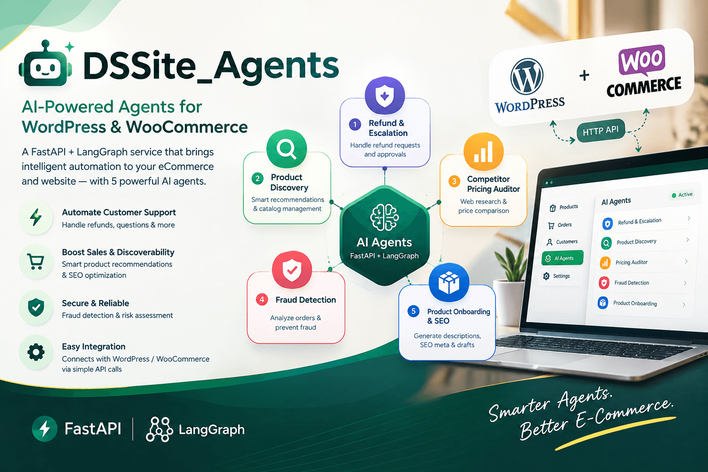

# DSSite Agents



# DSSite Agents

A site-agnostic AI agents API built with **FastAPI** and **LangGraph**.
The service exposes HTTP endpoints that a website can call, with
WordPress/WooCommerce integration snippets included in this repository.

> **Project status:** This README describes the implementation and
> configuration visible in the repository. It does not claim that the
> service is production-ready or that every endpoint has been tested in
> a deployed environment. Review the security and deployment notes
> before using it with real customers or orders.

-   **Repository:** https://github.com/Raheel32/DSSite_Agents
-   **API framework:** FastAPI
-   **Agent orchestration:** LangGraph
-   **LLM integration:** Google Gemini through `langchain-google-genai`
    (where configured)
-   **Web search for pricing research:** Tavily
-   **Database layer:** SQLAlchemy; local configuration defaults to
    SQLite, while the Render blueprint configures PostgreSQL

## What it does

The API is intended to let a website call agent workflows over HTTP
instead of embedding the agent logic directly into the website. The
repository includes five agent workflows:

1.  **Refund and escalation**: classifies a customer's message,
    evaluates order facts against configurable rules, and routes some
    requests to an administrator for review.
2.  **Product discovery and recommendations**: parses a shopper's query,
    searches the catalog maintained by the service, and ranks matching
    products.
3.  **Competitor pricing audit**: uses Tavily web search and price
    extraction/review logic to produce pricing-audit results.
4.  **Order fraud screening**: calculates a risk score from supplied
    order signals and returns a verdict. The current implementation
    contains example IP blocklist entries and configurable rule
    thresholds; this is a screening aid, not proof that an order is
    fraudulent.
5.  **Product onboarding and SEO**: accepts product details including an
    image payload, generates product copy and SEO fields, validates the
    draft, and supports a WordPress/WooCommerce integration intended to
    create a draft product.

The repository also contains WordPress PHP snippets for catalog
synchronization, AI product search, refund requests, administration,
price audits, and product onboarding.

## Architecture at a glance

``` text
WordPress / WooCommerce / another website
                  |
                  | HTTP requests
                  v
          FastAPI application
                  |
        +---------+----------+
        |         |          |
    LangGraph  SQLAlchemy  External APIs
    workflows  database    Gemini / Tavily
        |
        v
   JSON API responses
```

The application entry point is `app.main:app`. On startup, the current
entry point creates database tables and calls a seed routine. The
application exposes a health endpoint at `/health` and FastAPI's
interactive API documentation at `/docs`.

## Agents and API endpoints

The endpoint names below are based on the current application README and
router registration. Check `/docs` on your running instance for the
exact request schemas and response models.

  ------------------------------------------------------------------------------------
  Agent / capability      Endpoint(s)                          Purpose
  ----------------------- ------------------------------------ -----------------------
  Fraud screening         `POST /fraud/check`                  Evaluate order signals
                                                               and return a risk
                                                               assessment

  Refund request          `POST /refund/request`               Submit a refund or
                                                               cancellation request
                                                               for policy evaluation

  Refund administration   `POST /approve-refund`,              Review pending requests
                          `GET /refund/requests`               and record an
                                                               administrative decision

  Refund dashboard        `GET /admin`                         Separate admin
                                                               dashboard documented by
                                                               the project

  Product recommendations `POST /recommendations`              Search the service's
                                                               product catalog using
                                                               shopper intent

  Catalog management      `POST /catalog/products`,            Add/update or remove
                          `DELETE /catalog/products/{id}`      catalog items

  Catalog statistics      `GET /catalog/stats`                 Return catalog
                                                               statistics

  Product onboarding      `POST /onboarding/product`           Generate and validate
                                                               product information and
                                                               SEO content

  Competitor pricing      `POST /pricing/audit`,               Run a pricing audit and
                          `GET /pricing/audits`                retrieve previous
                                                               audits

  Pricing audit status    `POST /pricing/audits/{id}/status`   Mark an audit
                                                               suggestion as applied
                                                               or dismissed

  Service health          `GET /health`                        Basic health response

  Root information        `GET /`                              Return service
                                                               information and
                                                               documented endpoint
                                                               names
  ------------------------------------------------------------------------------------

Administrative endpoints and website-facing endpoints may use different
keys. Configure and verify authentication in the actual route
implementation before exposing the service publicly.

## Technology stack

Dependencies declared in `requirements.txt` include:

-   Python
-   FastAPI and Uvicorn
-   LangGraph and LangChain Core
-   `langchain-google-genai` for Gemini integration
-   SQLAlchemy
-   SQLite for the default local database configuration, or PostgreSQL
    when configured
-   `python-dotenv` for environment variables
-   HTTPX
-   Tavily Python client for web search

The dependency file currently contains repeated entries and uses version
lower bounds rather than a fully locked dependency set. For reproducible
deployments, consider cleaning up and locking dependencies after
compatibility testing.

## Requirements

-   Python 3.11 is the version specified by the repository's Render
    blueprint. A compatible Python version should also be used locally.
-   Git, if cloning the repository.
-   A Google AI API key for Gemini-backed functionality.
-   A Tavily API key for the competitor-pricing web-search workflow.
-   Suitable database configuration.
-   WordPress/WooCommerce only if you plan to use the provided PHP
    integrations.

Some agent code has fallback behavior when Gemini is unavailable, but
external-service-dependent functionality may be limited without the
relevant keys.

## Run locally

Commands below are examples for a fresh checkout. Run them from the
repository root.

### 1. Clone the repository

``` bash
git clone https://github.com/Raheel32/DSSite_Agents.git
cd DSSite_Agents
```

### 2. Create and activate a virtual environment

**Windows PowerShell**

``` powershell
py -3.11 -m venv .venv
.\.venv\Scripts\Activate.ps1
```

If PowerShell blocks activation, you can run the environment's Python
and pip executables directly, or follow your organization's PowerShell
execution-policy guidance.

**macOS / Linux**

``` bash
python3.11 -m venv .venv
source .venv/bin/activate
```

### 3. Install dependencies

``` bash
python -m pip install --upgrade pip
pip install -r requirements.txt
```

### 4. Configure environment variables

Copy the example file:

**Windows PowerShell**

``` powershell
Copy-Item .env.example .env
```

**macOS / Linux**

``` bash
cp .env.example .env
```

Edit `.env` and set appropriate values:

``` dotenv
# The checked-in example defaults to a local SQLite database.
DATABASE_URL=sqlite:///./agents.db

# Needed for Gemini-backed agent behavior.
GOOGLE_API_KEY=replace_with_your_google_ai_api_key
# Optional: set a supported Gemini model name.
# GEMINI_MODEL=gemini-flash-latest

# Needed for competitor pricing research.
TAVILY_API_KEY=replace_with_your_tavily_api_key

# Replace both placeholders with long, random secrets.
ADMIN_API_KEY=replace_with_a_long_random_admin_secret
SITE_API_KEY=replace_with_a_long_random_site_secret
```

Do not commit `.env` or real API keys to Git. Keep development and
production secrets separate. If using PostgreSQL, replace the SQLite URL
with a connection string compatible with the installed database driver
and your database provider.

### 5. Start the API

``` bash
uvicorn app.main:app --reload
```

Then open:

-   API documentation: http://127.0.0.1:8000/docs
-   Root endpoint: http://127.0.0.1:8000/
-   Health endpoint: http://127.0.0.1:8000/health

The `--reload` option is intended for local development, not production
deployment.

## Example request: fraud screening

The following example mirrors the request shape documented in the
repository README. Use a test order and your own local API URL:

``` javascript
fetch("http://127.0.0.1:8000/fraud/check", {
  method: "POST",
  headers: {
    "Content-Type": "application/json"
  },
  body: JSON.stringify({
    order_ref: "ORD-1001",
    customer_email: "ali@example.com",
    amount: 4500,
    payment_method: "cod",
    ip_address: "103.255.4.10",
    checkout_seconds: 90
  })
})
  .then(async (response) => {
    if (!response.ok) {
      throw new Error(`Request failed: ${response.status}`);
    }
    return response.json();
  })
  .then(console.log)
  .catch(console.error);
```

Use `/docs` to inspect required fields and the actual response schema
for every endpoint. The sample values are illustrative, not a real
order.

## Run the test scripts

The repository includes separate test scripts for the agent workflows:

``` bash
python test_fraud.py
python test_refund.py
python test_discovery.py
python test_pricing.py
python test_onboarding.py
```

Run them from the repository root with the project's virtual environment
activated. Some tests may require environment variables, a configured
database, or external API access. The presence of these scripts does not
mean they have passed in your environment; record actual results when
validating a change.

## WordPress / WooCommerce integration

The `wordpress/` directory contains PHP snippets documented for the
following integrations:

  -------------------------------------------------------------------------
  Integration file                      Documented purpose
  ------------------------------------- -----------------------------------
  `ds_agents_config_snippet.php`        Shared configuration for the
                                        integration snippets

  `refund_form_snippet.php`             Customer refund/cancellation
                                        request form

  `catalog_sync_snippet.php`            Synchronize catalog products with
                                        the agent service

  `ai_search_snippet.php`               AI product-search interface

  `ai_search_integration_snippet.php`   Connect the existing WordPress
                                        product search to the discovery
                                        agent, with a documented fallback

  `admin_dashboard_snippet.php`         WooCommerce admin interface for
                                        refund decisions and fraud flags

  `onboarding_page_snippet.php`         WooCommerce product onboarding
                                        interface intended to create draft
                                        products

  `price_audit_page_snippet.php`        WooCommerce interface for
                                        competitor pricing audits
  -------------------------------------------------------------------------

Review each PHP snippet before installing it. Confirm the endpoint URL,
request headers, key handling, WordPress hooks, permissions, and
compatibility with your WordPress/WooCommerce versions. Use a staging
site first, and do not paste secrets into public posts, screenshots, or
source control.

The separate `/admin` page can be disabled in the Render configuration
using `DISABLE_ADMIN_PAGE=1`, according to the project's existing
documentation. Verify the implementation and access controls before
relying on this setting.

## Deploying to Render

A `render.yaml` blueprint is included. It declares:

-   A Python web service named `ai-agents-service`
-   A PostgreSQL database named `agents-db`
-   A build command that installs `requirements.txt`
-   A Uvicorn start command bound to `0.0.0.0` and Render's `$PORT`
-   `/health` as the health-check path
-   Environment variables for the database URL, Google API key, Tavily
    API key, admin key, and site key

Typical workflow:

1.  Push the repository to GitHub.
2.  In Render, create a new Blueprint deployment from the repository.
3.  Review the proposed services, database, plan limits, and costs
    before confirming.
4.  Enter secret environment-variable values in Render's dashboard.
5.  Wait for deployment and check the service logs and health endpoint.
6.  Test the API endpoints and integrations in a staging environment
    before connecting a live store.

The blueprint uses free plans in its current configuration. Free-tier
availability, sleep behavior, database limits, and pricing can change,
so verify current Render terms before relying on it. A successful
deployment alone does not establish that all agents or integrations work
correctly.

## Security and production-readiness checklist

Before using this project with real customer or order data:

-   [ ] Restrict CORS origins in `app/main.py` to the domains that
    actually need access. The current code allows all origins.
-   [ ] Verify authentication and authorization on every administrative
    and website-facing route.
-   [ ] Use strong, unique secrets for `ADMIN_API_KEY` and
    `SITE_API_KEY`; never use the example placeholders in production.
-   [ ] Ensure secrets are stored in environment variables or an
    appropriate secret manager and are never committed.
-   [ ] Validate request payloads, amounts, identifiers, image sizes,
    and external-service responses.
-   [ ] Review refund policy rules against your real business policy.
    Test boundary cases and human-review paths.
-   [ ] Treat fraud scores as signals for review, not as definitive
    proof of wrongdoing.
-   [ ] Replace demo fraud indicators and example blocklist entries with
    a documented, maintained approach suitable for your use case.
-   [ ] Confirm database persistence and recovery behavior across
    application restarts, especially for workflows waiting for human
    approval.
-   [ ] Add automated tests for invalid inputs, authentication failures,
    database failures, timeouts, retries, and external API errors.
-   [ ] Configure logging, monitoring, backups, rate limiting, and
    appropriate retention/deletion of customer data.
-   [ ] Test WordPress integrations on staging and verify user
    capabilities and nonces for admin actions.
-   [ ] Review privacy, data-protection, and applicable legal
    requirements before processing customer information.

This checklist is not a security certification. The code, configuration,
and deployment environment need a full review before production use.

## Known implementation considerations

These are important limitations visible in the current repository:

-   CORS is configured to allow every origin in `app/main.py`; the
    source itself says to tighten this before going live.
-   The fraud agent includes sample blocked IP addresses and rule-based
    thresholds. These are demonstration rules, not a complete
    fraud-prevention system.
-   The local `.env.example` defaults to SQLite, while the Render
    blueprint provisions PostgreSQL. Validate both configurations
    independently.
-   The app startup creates database tables and runs a seed routine.
    Confirm that the seed behavior is appropriate for the database and
    environment you deploy.
-   The dependency list contains duplicate entries and does not lock
    exact versions.
-   External Gemini and Tavily calls can fail because of missing keys,
    network errors, quotas, or model availability. Test fallback
    behavior and error handling.
-   Human-review workflows and in-memory LangGraph checkpointing need
    careful persistence testing across restarts and multiple service
    instances.

## Project layout

Key paths documented or referenced by the repository include:

``` text
DSSite_Agents/
├── app/
│   ├── main.py
│   ├── agents/
│   │   ├── refund_agent.py
│   │   ├── discovery_agent.py
│   │   ├── fraud_agent.py
│   │   ├── pricing_agent.py
│   │   └── onboarding_agent.py
│   ├── routers/
│   ├── database.py
│   └── seed.py
├── wordpress/
├── .env.example
├── requirements.txt
├── render.yaml
├── test_refund.py
├── test_discovery.py
├── test_fraud.py
├── test_pricing.py
└── test_onboarding.py
```

This is a high-level guide to the key paths referenced by the project,
not a guarantee that every folder contains only the files shown above.

## Contributing

Contributions and issue reports are welcome.

1.  Fork the repository and create a focused branch.
2.  Describe the issue or proposed change.
3.  Add or update tests for the behavior being changed.
4.  Run the relevant test scripts and report any required environment
    variables or external services.
5.  Open a pull request with a clear summary and testing notes.

Please do not include API keys, credentials, real customer records, or
production order data in issues, commits, or test fixtures.

## License

No license is specified in this README. Check the repository for a
`LICENSE` file before reusing, distributing, or modifying the code. If
you intend to make this project open source, add an explicit license
that matches your intended terms.

## Disclaimer

This project provides agent workflows and integrations for
experimentation and development. Generated product copy,
recommendations, pricing research, refund routing, and fraud assessments
should be reviewed and validated for the intended business context. Do
not treat outputs as guaranteed accurate or use the service with live
transactions until appropriate testing, security review, and operational
controls are in place.
