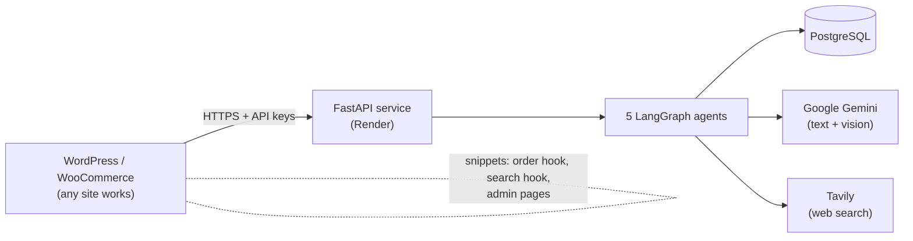

# AI Agents for E-Commerce (FastAPI + LangGraph)

Five LangGraph agents that plug into **any** online shop over HTTPS, demonstrated on a live
WordPress / WooCommerce grocery store (Discount Shop). Built as the Saylani Agentic AI mid-capstone.

| | |
|---|---|
| **Live shop (WordPress + WooCommerce)** | https://testv3.websitedemolynk.com/discountv2/ |
| **Agent service (FastAPI on Render)** | https://ai-agents-service-tdhq.onrender.com (`/docs` lists every endpoint) |
| **Repository** | https://github.com/Raheel32/DSSite_Agents |
| **Business requirements** | [`docs/BRD_Capstone_Project.pdf`](docs/BRD_Capstone_Project.pdf) |
| **UAT checklist (103 tests)** | [`docs/UAT_Checklist.xlsx`](docs/UAT_Checklist.xlsx) |

> The agent service runs on Render's free tier, which sleeps when idle. The first request after a
> quiet period can take up to a minute.

## Architecture



The agents never touch the shop's database. The shop sends the facts an agent needs (order, search
text, photo, price) and receives a decision. WordPress code lives in small
[Code Snippets](wordpress/) files, so the same service can serve a different shop with a different adapter.

## The five agents

| # | Agent | What it does | LangGraph ideas shown |
|---|---|---|---|
| 1 | **Smart Refund & Escalation** | Reads a refund/cancel request, applies the refund policy, auto-decides simple cases and pauses large or unclear ones for an admin | Sequential steps, conditional edges, **human-in-the-loop** (`interrupt_before`), checkpointer |
| 2 | **Product Discovery** | Turns "winter jacket and shoes under 5000" into ranked products from the synced catalog; plugged into the shop's own search bar | **Parallel branches** (`Send`), **custom reducer** that merges branch results |
| 3 | **Competitor Pricing Auditor** | Searches Pakistani stores for the same product and pack, reviews the evidence, suggests lower / raise / keep | **Iterative loop** with a `reviewer_node`, tool use (Tavily) |
| 4 | **Order Fraud Detection** | Scores every new order (IP, payment, speed, repeats) and marks it Safe or Flagged | **Sequential pipeline**, accumulating state reducer |
| 5 | **Product Onboarding & SEO** | Vendor gives a photo and a name; the agent writes description, SEO title/meta, tags, category | Gemini **Vision**, **iterative refinement** with a `validation_node` |

Design rules used across the agents:

* **The LLM understands, Python decides.** Gemini classifies text or reads photos; money decisions, validation and
  ranking are plain Python rules, so a customer cannot talk the AI into a refund.
* **Never invent facts.** Competitor prices must literally appear in the page text; generated product text may not
  claim "organic", "halal" etc. unless the name or the pack shows it.
* **Fail safe.** If Gemini, Tavily or the service is slow or down, the shop keeps working (normal search, orders
  never blocked, template text flagged "needs review").
* **A person stays in charge.** Refund approvals, price changes and publishing are always explicit clicks.

## Repository layout

```
app/
  main.py                 FastAPI app, CORS, routers
  database.py  models.py  schemas.py  security.py  seed.py
  agents/                 fraud_agent  refund_agent  discovery_agent  onboarding_agent  pricing_agent
  routers/                fraud  refund  recommendations  catalog  onboarding  pricing  admin
  static/admin.html       optional standalone admin page
wordpress/                Code Snippets for the shop (see install order below)
docs/                     BRD and UAT checklist
test_*.py                 one self-test per agent
render.yaml               Render blueprint (web service + PostgreSQL)
```

## Run it locally

```bash
python -m venv venv && source venv/bin/activate      # Windows: venv\Scripts\activate
pip install -r requirements.txt
cp .env.example .env                                  # Windows: copy .env.example .env
uvicorn app.main:app --reload                         # open http://127.0.0.1:8000/docs
```

Without a database setting it uses a local SQLite file. Without Gemini or Tavily keys the agents use their
offline fallbacks.

### Environment variables

| Variable | Purpose |
|---|---|
| `DATABASE_URL` | PostgreSQL URL (Render fills it in); SQLite when empty |
| `GOOGLE_API_KEY` | Gemini (intent, query understanding, vision, text) |
| `TAVILY_API_KEY` | Web search for the pricing agent |
| `SITE_API_KEY` | Key the **shop** sends with its requests |
| `ADMIN_API_KEY` | Key for admin endpoints (approvals, lists, audits) |
| `GEMINI_MODEL` | Optional model override (default `gemini-flash-latest`) |
| `DISABLE_ADMIN_PAGE` | Set to `1` to hide the standalone `/admin` page |

If `SITE_API_KEY` / `ADMIN_API_KEY` are empty the protection is off (local development only).

## Deploy on Render

1. Push this repo to GitHub.
2. Render: **New > Blueprint** and pick the repo (reads `render.yaml`), or create a PostgreSQL database and a
   Python web service by hand with build `pip install -r requirements.txt` and start
   `uvicorn app.main:app --host 0.0.0.0 --port $PORT`.
3. Add the environment variables above.
4. Open `/health`, then `/docs`.

## Connect a WordPress / WooCommerce shop

Install the files in [`wordpress/`](wordpress/) as PHP snippets (Code Snippets plugin, run everywhere):

| Order | File | What it adds |
|---|---|---|
| 1 | `ds_agents_config_snippet.php` (priority 1) | The only place where the two keys are pasted |
| 2 | `fraud_check_snippet.php` | Agent 4 on every order |
| 3 | `refund_form_snippet.php` | `[ds_refund_form]` shortcode for Agent 1 |
| 4 | `catalog_sync_snippet.php` | Automatic product sync + WooCommerce > Sync to AI agents |
| 5 | `ai_search_integration_snippet.php` | Agent 2 inside the existing search bar |
| 6 | `admin_dashboard_snippet.php` | WooCommerce > AI Agents (refund approvals, fraud flags) |
| 7 | `onboarding_page_snippet.php` | WooCommerce > AI Product Onboarding (Agent 5) |
| 8 | `price_audit_page_snippet.php` | WooCommerce > AI Price Audit (Agent 3) |

## API overview

| Endpoint | Auth | Agent |
|---|---|---|
| `POST /fraud/check` | site key | 4 |
| `GET /fraud/flagged`, `GET /fraud/history` | admin key | 4 |
| `POST /refund/request`, `GET /refund/{id}/status` | site key | 1 |
| `GET /refund/requests`, `POST /approve-refund` | admin key | 1 |
| `POST /recommendations` | site key | 2 |
| `POST /catalog/products`, `DELETE /catalog/products/{id}` | site key | 2 |
| `GET /catalog/stats` | admin key | 2 |
| `POST /onboarding/product` | site key | 5 |
| `POST /pricing/audit`, `GET /pricing/audits`, `POST /pricing/audits/{id}/status` | admin key | 3 |
| `GET /health` | none | - |

## Security notes

* Secrets live only in Render's environment and one WordPress config snippet; `.env` is git-ignored.
* WordPress calls the service from the **server**, so keys never reach a browser.
* Everything customers type is escaped before it is shown in an admin screen.
* Smart search is rate limited per visitor and cached for 10 minutes.
* Restrict CORS (`allow_origins` in `app/main.py`) to your shop's domain before real traffic.

## Tests

```bash
python test_fraud.py && python test_refund.py && python test_discovery.py && python test_onboarding.py && python test_pricing.py
```

Each test uses its own throw-away database and fake Gemini / Tavily answers, so no keys or internet are needed.
The manual acceptance tests are in [`docs/UAT_Checklist.xlsx`](docs/UAT_Checklist.xlsx).

## BRD requirements and where they are met

| BRD item | Status | Where |
|---|---|---|
| Base e-commerce platform | Adapted: an existing WooCommerce store is used (agreed with the instructor, who asked for site-independent agents) | Live shop |
| Cash on Delivery and bank transfer only | WooCommerce payment settings | UAT PAY-01 to PAY-06 |
| Admin dashboard | WooCommerce admin plus WooCommerce > AI Agents | `admin_dashboard_snippet.php` |
| UAT before AI | 103-test checklist | `docs/UAT_Checklist.xlsx` |
| Agent 1 (conditional + human-in-the-loop) | Done | `app/agents/refund_agent.py` |
| Agent 2 (parallel + reducers) | Done | `app/agents/discovery_agent.py` |
| Agent 3 (iterative, tool routing) | Done | `app/agents/pricing_agent.py` |
| Agent 4 (sequential) | Done | `app/agents/fraud_agent.py` |
| Agent 5 (iterative, Gemini vision) | Done | `app/agents/onboarding_agent.py` |
| FastAPI, SQLAlchemy, PostgreSQL, LangGraph, LangChain, Gemini, Tavily | Used | `requirements.txt` |
| Render deployment | Done | `render.yaml` |

## Known limitations

* Free-tier hosting sleeps when idle; a keep-alive ping or a paid instance removes the delay.
* Web prices can be outdated or from marketplaces with several sellers; the pricing agent shows its sources for a human to judge.
* Approving a refund records the decision; the actual WooCommerce refund is still done by a person.
* Gemini and Tavily free quotas limit how many audits and onboardings can run per day.
